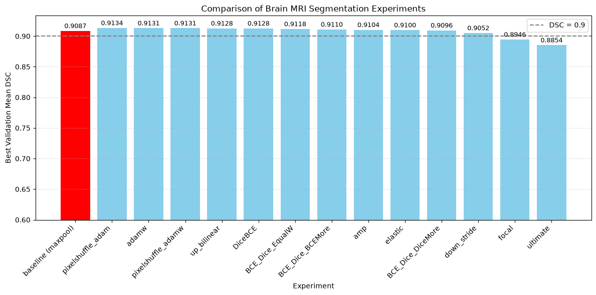
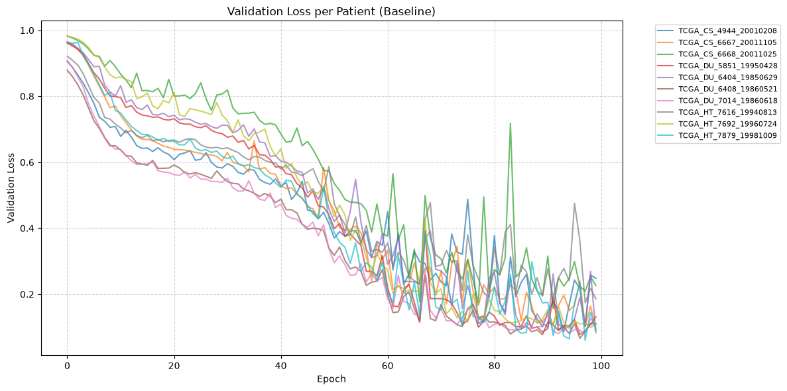
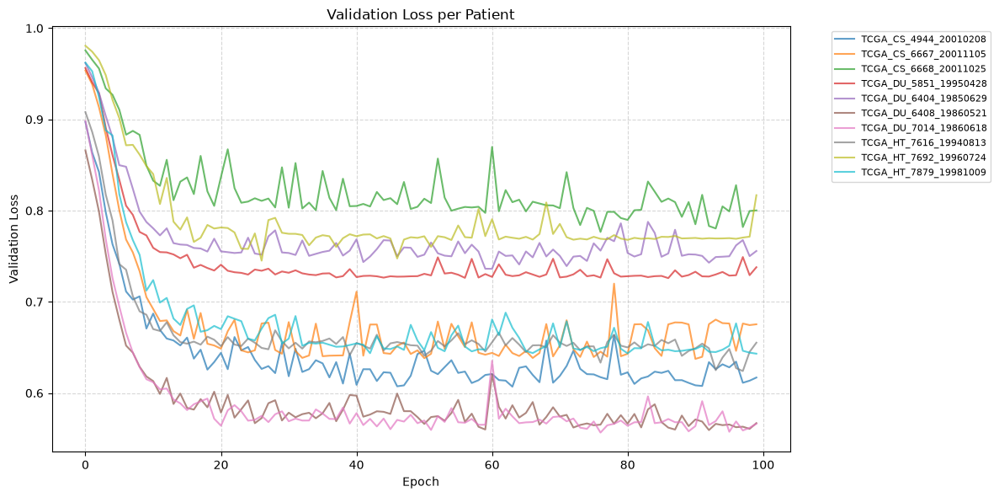

# Brain MRI Image Segmentation

> **Course project | Deep learning portfolio**

Medical image segmentation and U-Net experiments.

## Project overview

Study U-Net-based brain image segmentation, loss functions, preprocessing, and comparisons.

## Experiment notebooks

- [`hw4_-inference.ipynb`](notebooks/hw4_-inference.ipynb)
- [`mri-skimage-compare.ipynb`](notebooks/mri-skimage-compare.ipynb)
- [`mri-skimage-compare2.ipynb`](notebooks/mri-skimage-compare2.ipynb)
- [`mri-skimage-compare3.ipynb`](notebooks/mri-skimage-compare3.ipynb)
- [`mri-skimage-compare4.ipynb`](notebooks/mri-skimage-compare4.ipynb)
- [`mri-skimage-compare5-dicebce.ipynb`](notebooks/mri-skimage-compare5-dicebce.ipynb)
- [`mri-skimage.ipynb`](notebooks/mri-skimage.ipynb)

## Source code

Python modules are kept separately in `src/` to make the implementation easier to review and reuse. Some notebooks use `%%writefile` to generate these modules during Colab execution. **The notebook is the orchestration layer; the scripts are the implementation layer.**

- [`src/dataset.py`](src/dataset.py)
- [`src/dataset_exp.py`](src/dataset_exp.py)
- [`src/loss.py`](src/loss.py)
- [`src/loss_exp.py`](src/loss_exp.py)
- [`src/train.py`](src/train.py)
- [`src/train_exp.py`](src/train_exp.py)
- [`src/transform.py`](src/transform.py)
- [`src/transform_exp.py`](src/transform_exp.py)
- [`src/unet.py`](src/unet.py)
- [`src/unet_exp.py`](src/unet_exp.py)
- [`src/utils.py`](src/utils.py)

## Selected visuals from the saved notebook

These images are extracted from previously saved notebook outputs; they were not regenerated or independently validated.

## Reproduction and compute

These experiments were developed primarily in Google Colab; **GPU acceleration may be required**, especially for training. Open the notebook in Colab, mount/download the required dataset, and update its filesystem paths and configuration before execution. Dataset and checkpoint files are not bundled unless explicitly noted.

> **Reproducibility status:** Code and saved notebook outputs are included as submitted, but the workflows have **not been re-executed end-to-end** in this packaged repository. Exact dependencies, dataset permissions, and runtime availability may differ.

## Language and preservation

The GitHub documentation is in English. The notebooks in `notebooks/` contain an **English overview pass** for Chinese markdown commentary and selected standalone comments, while preserving code behavior. **This is not a complete line-by-line translation.** Chinese code literals, detailed original reports, and runtime outputs may remain. Complete unmodified notebooks are delivered separately in `deep-learning-original-archive.zip` (not included in this GitHub upload).

## Next improvements

- Verify data acquisition, paths, dependencies, and GPU runtime.
- Review notebook outputs and document measured metrics with evaluation protocol.
- Perform a manual translation review, especially for code comments and graph labels.
- Refactor hardcoded Colab paths into explicit configuration without changing model behavior.
