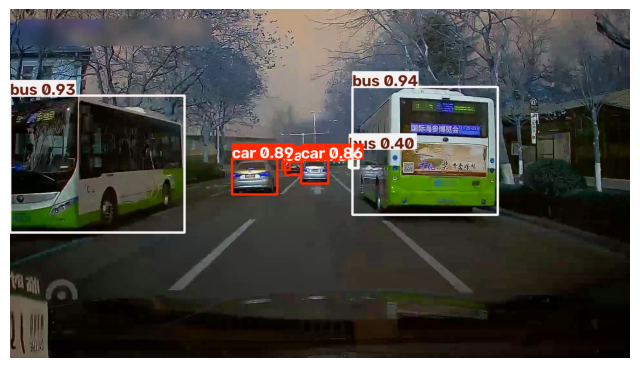
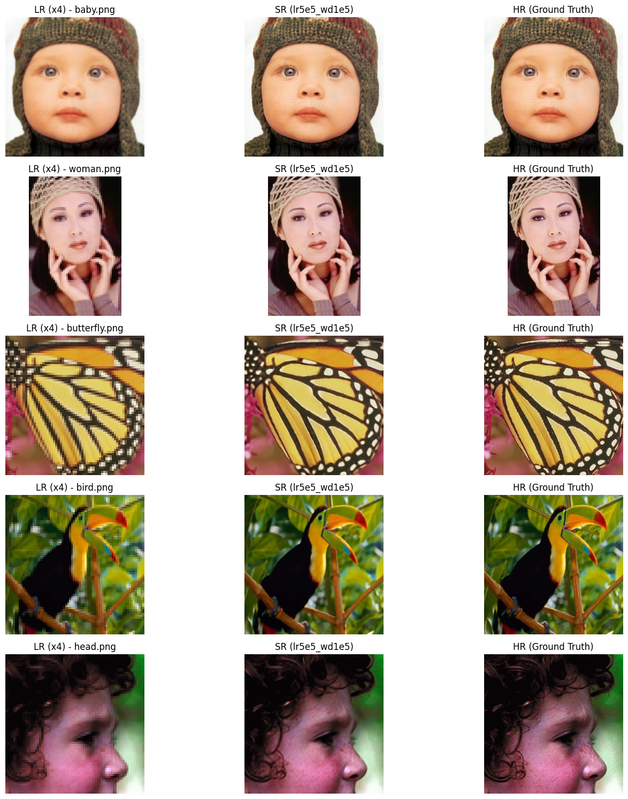
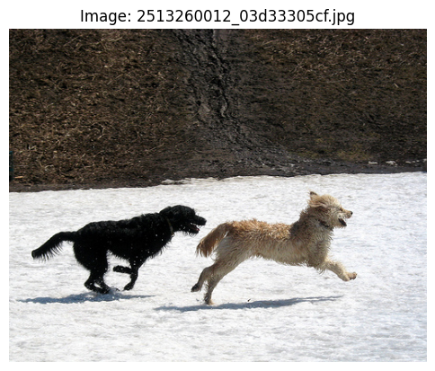
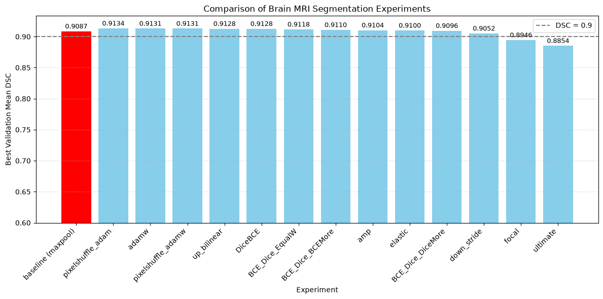

# Deep Learning Projects

**From neural network fundamentals to computer vision and multimodal learning.**

   

A portfolio of **seven course-based deep learning projects**, developed primarily with Python and Google Colab. The collection spans image classification, neural network implementation, medical imaging, object detection, image-to-text generation, and image reconstruction.

[**Explore featured projects**](#featured-projects) · [**Browse all seven**](#all-projects) · [**Run in Colab**](COLAB_SETUP.md)


*Gallery assembled from saved notebook figures. Examples and charts are from different experiments; the figure is a portfolio overview, not a unified benchmark.*

## Featured projects

### 01 · Traffic Scene Object Detection

[](05-traffic-object-detection/README.md)

**YOLO-family models · RT-DETR · Traffic imagery**

Investigates object detection for road scenes, including detector comparisons and prediction visualizations. The linked example shows detection boxes and confidence scores from a saved notebook output.

**[View project, notebooks, and source →](05-traffic-object-detection/README.md)**

### 02 · Image Super-Resolution

[](07-image-super-resolution/README.md)

**SRResNet · SRGAN · Reconstruction experiments**

Experiments with super-resolution pipelines and reconstruction at different scaling factors. The visual contains example images extracted from saved experiment outputs.

**[View project, notebooks, and source →](07-image-super-resolution/README.md)**

### 03 · Image Caption Generation

[](06-image-captioning/README.md)

**Flickr8k · Encoder–decoder architecture · Attention · Beam search**

Explores vision-to-language modeling, including caption generation, decoding strategies, and validation comparisons. The picture is a saved dataset/experiment example; it should **not** be interpreted as a validated model-generated caption.

**[View project, notebooks, and source →](06-image-captioning/README.md)**

### 04 · Brain MRI Image Segmentation

[](04-brain-mri-segmentation/README.md)

**U-Net · Segmentation losses · Experiment comparisons**

Studies medical image segmentation with U-Net variants, preprocessing, and loss-function experiments. The chart is drawn from recorded notebook outputs, not a new evaluation.

**[View project, notebooks, and source →](04-brain-mri-segmentation/README.md)**

## All projects

| Project | Focus | Explore |
|:--|:--|:--|
| **01 · CIFAR-10 Image Classification** | Classification, model training, and learning curves | [Open](01-cifar10-image-classification/README.md) |
| **02 · Multilayer Perceptron from Scratch** | Network components, optimization, and backpropagation | [Open](02-mlp-from-scratch/README.md) |
| **03 · PyTorch in Practice** | Applied training and evaluation workflows | [Open](03-pytorch-practice/README.md) |
| **04 · Brain MRI Image Segmentation** | U-Net and loss-function experiments | [Open](04-brain-mri-segmentation/README.md) |
| **05 · Traffic Scene Object Detection** | YOLO-family models and RT-DETR | [Open](05-traffic-object-detection/README.md) |
| **06 · Image Caption Generation** | Flickr8k, attention, and beam search | [Open](06-image-captioning/README.md) |
| **07 · Image Super-Resolution** | SRResNet and SRGAN | [Open](07-image-super-resolution/README.md) |

## How the repository is organized

```text
deep-learning-projects/
├── 01-cifar10-image-classification/
├── 02-mlp-from-scratch/
├── 03-pytorch-practice/
├── 04-brain-mri-segmentation/
├── 05-traffic-object-detection/
├── 06-image-captioning/
├── 07-image-super-resolution/
├── assets/featured-projects.jpg
├── COLAB_SETUP.md
└── README.md
```

Within each project, **`notebooks/`** documents the experiments, **`src/`** (where available) exposes standalone Python modules, and **`assets/`** contains selected saved figures. Several source files were originally produced with Colab's `%%writefile`; retaining them as `.py` makes architecture and training code easier to inspect separately from notebook execution.

## Running the experiments

Most experiments were developed on **Google Colab**, with GPU acceleration useful or necessary for training certain models. Open the relevant notebook, set up dependencies and datasets, then update any Google Drive mounts or hard-coded paths. See [Colab setup notes](COLAB_SETUP.md) before attempting to reproduce a run.

> **Documentation and reproducibility:** This is a curated **coursework portfolio**, not a verified end-to-end reproducible software release. Results and example figures come from saved notebooks and have **not** been rerun or independently verified for this packaging. README documentation is in English; some notebook strings, plots, detailed commentary, and outputs remain untranslated. The complete untouched originals and PDF reports are stored in a separate backup archive, rather than the public repository. Datasets and trained checkpoints are generally excluded.

## Notes and attribution

Projects are presented as educational experiments. Dataset, framework, and pretrained-model licenses remain with their original owners. Individual project pages contain relevant implementation details and limitations.
